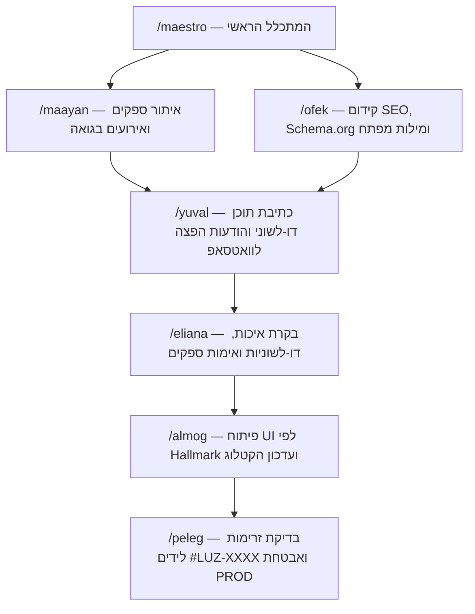

# מערכת הסוכנים של LUZ Goa (The LUZ Goa Agent OS)

מערכת סוכני ה-AI של **LUZ Goa** בנויה במתכונת של צוות צמיחה, תוכן, בקרת איכות, SEO ופיתוח (בהשראת ארכיטקטורת הסוכנים של `podkids`), כדי לקדם את האפליקציה בדרום גואה, לגייס ספקים ומשתמשים, ולשמור על איכות קוד ועיצוב ברמת **Together AI Hallmark**.

---

## מבנה התיקיות (`brain/` + `.claude/commands/`)

```text
c:\Antigravity\GOA\
├── brain/
│   ├── PLAN.md                      # מסמך ארכיטקטורת הסוכנים וזרימת העבודה
│   ├── core/
│   │   └── voice-dna.md             # חוקת המותג, הטון הדו-לשוני וכללי Hallmark
│   ├── memory/
│   │   └── MEMORY.md                # זיכרון ארגוני משותף לכל הסוכנים
│   └── agents/
│       ├── maestro-agent.md         # 1. מאסטרו — המתכלל ומנהל הצמיחה הראשי
│       ├── maayan-agent.md          # 2. מעיין — סוכן הגילוי, ציד לידים וגיוס ספקים בגואה
│       ├── yuval-agent.md           # 3. יובל — הקופירייטר הדו-לשוני והפצה בוואטסאפ/סושיאל
│       ├── eliana-agent.md          # 4. אליאנה — שומרת הסף (בקרת איכות למודעות, עסקים ו-Brand DNA)
│       ├── ofek-agent.md            # 5. אופק — מומחה SEO, גוגל, Schema.org וצמיחה אורגנית
│       ├── peleg-agent.md           # 6. פלג — בודק זרימות, אבטחה, Firestore ולידים (#LUZ-XXXX)
│       └── almog-agent.md           # 7. אלמוג — מפתח Frontend ואדריכל עיצוב Hallmark
└── .claude/
    └── commands/
        ├── maestro.md               # /maestro
        ├── maayan.md                # /maayan
        ├── yuval.md                 # /yuval
        ├── eliana.md                # /eliana
        ├── ofek.md                  # /ofek
        ├── peleg.md                 # /peleg
        └── almog.md                 # /almog
```

---

## זרימת העבודה לקידום והפעלת LUZ Goa


